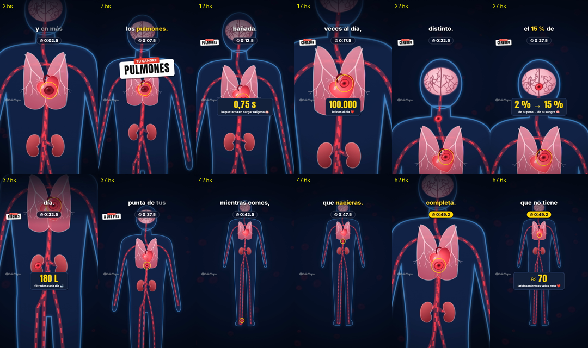

# QA · E01-viaje-de-tu-sangre · 2026-11-23

Resultado: **8/9**

- ✅ Duración 30-90 s
- ✅ Luz media 35-150
- ✅ Sin zonas quemadas (<8 % de píxeles a blanco en el peor fotograma)
- ✅ Sin pantallas negras (<70 % de píxeles negros en el peor fotograma)
- ✅ Cambio visual frecuente (≥ 3 por cada 10 s)
- ❌ Ninguna imagen quieta > 3 s
- ✅ Volumen -14 LUFS ±1
- ✅ Pico ≤ -1 dBTP
- ✅ Voz entendible (≥ 0,85 de coincidencia con el guion)

```
{
 "slug": "E01-viaje-de-tu-sangre",
 "date": "2026-11-23",
 "duration": 60.1,
 "mean_light": 39.4,
 "worst_blown_pct": 2.7,
 "worst_crushed_pct": 0.4,
 "visual_changes_per_10s": 7.2,
 "longest_still_s": 7.5,
 "lufs": -14.1,
 "true_peak_dbfs": -1.2,
 "voice_match": 0.929,
 "passed": 8,
 "total": 9
}
```

